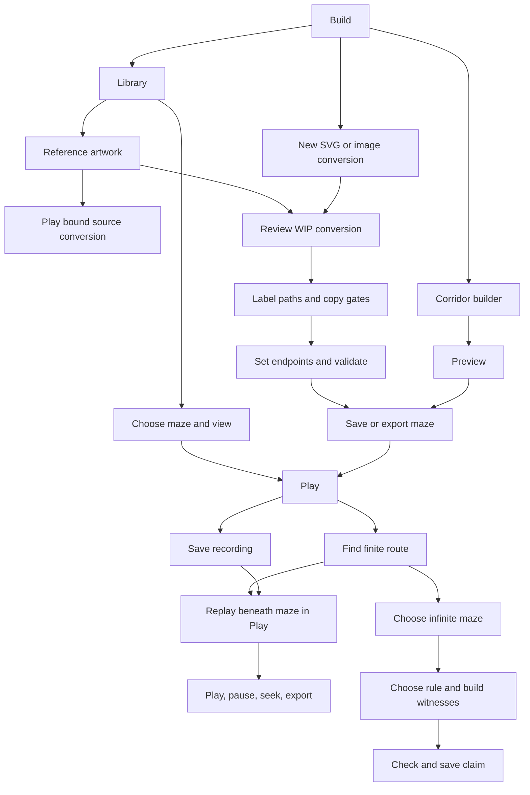

# Maze product and navigation flows

Home offers Play, Solve & analyze and Build with compact instructions. Library browses author collections. Play uses the maze movement model and places replay selection beneath its field. Solve & analyze selects mazes, simplifies PDAs, searches finite routes and opens manual proofs.

## Browse and play

Library groups 74 document variants into 49 maze families by author, with author/search/type filters and source drawings and remakes under Maze view. Reference artwork uses the same author collections. Reference artwork preserves all 41 original assets plus two README-backlog sources, including ten research diagrams. Bound source conversions have Play links beside their original files. WIP labels and conversion notes expose uncertainty.

Path/PDA drafts without a start or finish open Review conversion from their card. Alternate views and direct Play URLs also open the conversion workspace after loading the actual saved document. A saved draft with both endpoints keeps Play. This distinguishes unfinished artwork from playable WIP interpretations such as Berkly.

Alice opens in its block view; its original drawing remains selectable. Ten duplicate geometric remake views have been removed from the defaults. The two unique geometric originals remain, and all twelve geometric import templates use physical PDA-backed block play with their original floor cells. Original diagrams remain covers and original-format exports. Selecting a different maze document starts a new run and warns if play is unfinished. Different representations keep separate document IDs, gate labels and snapshots. The selector does not translate an active position between different topologies. SP3’s original/revised drawings, Daedalus 2’s photo/native model and the A Long Path variants have explicit variant labels and WIP notes.

## Build and convert

Build (`/build`) opens four choices: corridor drawing, a fresh image/PDA conversion, editing a Library maze, and constructing an infinite proof. A new image workspace (`/workbench/new`) gets a fresh project ID and editable name. Upload or choose artwork, label connected paths, place frames and anchors, and declare enter/exit transitions. Save keeps it in this browser; export produces a portable `.fmaze`.

Conversion belongs in Build and the Solve & analyze workspace. The native corridor builder exposes structure, blocks, links, player/finish, previews, undo/redo, save and export. Richer native formats keep the original maze and create a separate WIP tracing project. Geometric and recursive-port definitions instead compile directly into the actual playable PDA in Build.

## Search and replay

Solve & analyze has title/author search and author/type filters. Families open the view matching a type filter. Source and corridor views use simplified PDA search; corridor grid BFS/IDDFS remains available. Other representations link their native search controls. A result opens under its maze in Play. Search limits are displayed; bounded failure is not an infinite-maze proof.

The replay bar beneath Play combines player recordings, saved solver routes and 74 shared solution replays covering 64 document variants. Library has no replay cards and there is no Replays navigation tab. Remaining solutions are listed in [coverage](SOLUTION_COVERAGE.md). Replay snapshots preserve the recorded maze independently of later edits. Playback, speed, stepping, seeking, import and export operate on that snapshot.

A revisit removes the detour using the copy address, path and physical point. New source/block recordings retain keyboard and mouse walks as well as the exact PDA copy transitions, together with the selected immutable geometry. Undo and restart restore the actual path position. Older gate-only recordings reconstruct their travel between anchors and remain playable. Playback can pause and resume the final movement before its drawn endpoint.

## Grid tours and block expansions

Backlot’s Play view tracks the dots and numbered lines separately for every room. Entering a studio pushes a fresh room through the facing gate; leaving resumes in the parent. Retracing is blocked; Undo revises the drawing. The supplied tour stays optional, and completed rooms can show the exit markings.

Block Play supports exact recursive keyboard/touch walking, zoom, worker BFS, endpoint/pattern editing and saved replays. Zoom preserves position and history; recordings retain exact radix coordinates and each move's detail. The initial-view control changes the display without resetting the run. Changing the pattern or endpoints starts a new run and removes the stale supplied route. Search detail has a separate bounded control, and failure applies only to that finite expansion. Existing finite-grid recordings remain readable and retain their original export.

## Infinite evidence

A proof notebook starts empty. Its main view shows connection selection, trail controls and the repeating word. Copy addresses/scope, route histories, related Cantor hypotheses and the proven-connection inventory are disclosed on demand; source artwork stays in Trace & PDA. The user chooses an endpoint claim and movement rule, then constructs its witnesses using legal actions. Checks distinguish finite routes, repeating-word infinite hops and strictly deeper Cantor hypotheses. Left/right setup trails lead to anchors before a common repeating copy word; copy-address comparison is available in a foldout. Earlier checked lemmas can support later claims. Distinct proofs of the same endpoints remain saved but appear as one proven connection. A connection route from start to finish can save and play a proof-assisted replay with its checked claims embedded. This snapshot never fills the original notebook automatically. Editing topology or rules invalidates stale evidence.

Windischer’s three drawings remain one Library family with conversion-review workspaces. Jay confirmed that the layers show infinite recursion. Its terminal table and the rule for crossing the limit point remain unresolved, so these drawings remain unbound WIP conversions. The candidate gate guesses were removed, and no automatic proof or central jump is supplied.

Repeated-register Play and replay default to the legal next connections, avoiding a full map of overlapping wires. The camera frames the current copy and legal destinations, labels visible copies and highlights ownership at shared boundary points. The complete connection map remains an optional live display; movement rules and saved trails are unchanged.

## Persistence and review

Saved projects appear in Library. If an older saved catalog draft shadows a newly converted default, Copy current catalog maze creates an independent current copy and preserves the user’s earlier project. Export preserves the selected definition, source geometry, notes and unfinished proof. Browser storage is local; exported files remain portable.

Source keyboard walking follows bends and stops at junctions/gates. Four source/corridor pairs reuse a verified common PDA; other variants retain their distinct topology. All 28 bound source Play sessions start with generated block artwork; their original drawings remain selectable and serve as Library covers. [Current implementation and verification](UNIFIED_PLAY.md).

Source/corridor display changes within the same source document retain the active position. Selecting another document or leaving unfinished play prompts before discarding the run. Snuke offers orthogonal block artwork and its source curves with a moving parent-copy location dot; bundled port models use PDA movement underneath. Skeptic Play 2's unrelated native grid has its own Sierpinski corridor maze entry and replay. Wolfram 1 offers its source drawing and block display; Wolfram 2 has its photograph and block remake. Earlier same-maze recordings remain available beneath the current maze, including all eleven original Wolf solutions beneath Wolfram 2. Old saved documents remain loadable.

Replay movement follows route distance and Pause holds the displayed dot. Block and source Play omit blocked/backtrack counters and wall flashes. Omeometo opens the whole base pattern with smaller copies visible inside black cells. Zoom reveals passages without moving the player. The marker stays small, and a parent-copy inset tracks deeper positions; displayed depth counts actual black-copy ancestors rather than view detail.
